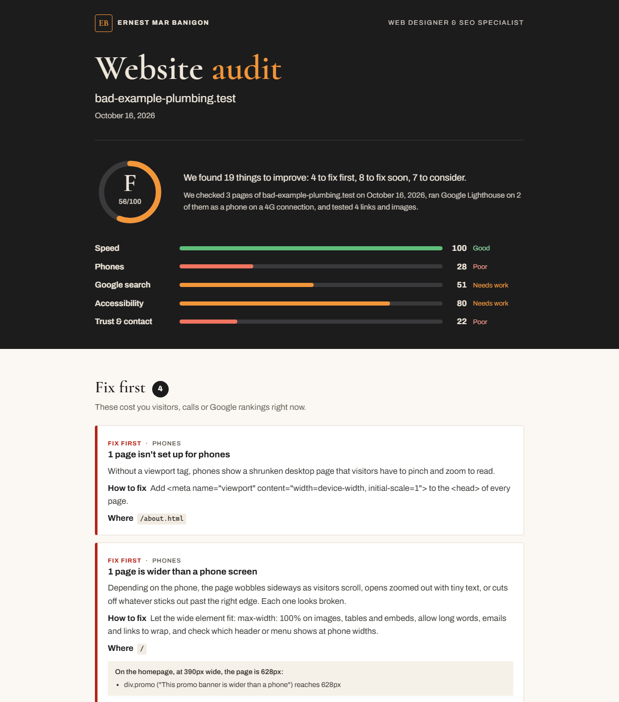

# site-audit

Audit a small-business website in one command and get a report the owner can actually read.

```
node audit.mjs example.com
```

It crawls the site like a visitor would, on a desktop and on a phone, runs Google Lighthouse, and checks the things that cost a local business calls and customers: slow pages, layouts that break on phones, phone numbers you can't tap, pages Google can't list, broken links and forms that never arrive. The result is a branded, single-file HTML report plus a print-ready PDF that explains **what's wrong, why it matters and how to fix it**, in plain words, ranked by what to fix first.



See the full [sample report (PDF)](examples/sample-report.pdf), made from a fictional plumber's site with planted mistakes.

## What it checks

| Area | Checks |
|---|---|
| **Speed** | Lighthouse performance on a phone with slow 4G: how long the main content takes to appear (LCP), layout shift (CLS), frozen time (TBT), page weight and the biggest savings |
| **Phones** | Viewport tag, pages wider than the screen (whether they scroll sideways or get cut off), tap-to-call phone numbers, tap target size |
| **Google search** | `noindex` tags and headers, robots.txt blocking the site, missing, duplicate or overlong titles, missing or duplicate descriptions, H1 headings, LocalBusiness structured data, sitemap, share image, plus Lighthouse SEO |
| **Accessibility** | Images without alt text, page language, plus Lighthouse accessibility (contrast, unlabeled buttons, links and form fields…) |
| **Trust & contact** | HTTPS and the http→https redirect, insecure files, broken links (internal and external) and images, a way to get in touch, `mailto:` forms, an outdated © year, favicon, script errors |

Each finding comes with a severity (**Fix first**, **Fix soon**, **Nice to have**), the pages it affects and evidence such as the element that's too wide or the link that 404s. The report also lists what's already working, scores five areas, shows the homepage on desktop and phone, and ends with your contact details.

## Usage

Needs Node 20+ and Google Chrome.

```
npm install
node audit.mjs https://example.com
```

| Option | Default | |
|---|---|---|
| `--pages N` | 10 | Pages to crawl: shallow pages first (About, Contact, Services), menu links before body links |
| `--lighthouse N` | 2 | Pages to run Lighthouse on: the homepage, then the contact page. `0` skips Lighthouse |
| `--brand FILE` | `brand.json` | Name, contact details, accent colour and closing note for the report |
| `--out DIR` | `reports/<site>-<date>` | Where to write `report.html` and `report.pdf` |
| `--no-pdf` | | Skip the PDF |
| `--json` | | Also save the raw data as `data.json` |

A 10-page audit takes two to four minutes, most of it Lighthouse. Reports go to `reports/`, which git ignores, so audits of real businesses stay on your machine.

### Your own branding

Edit `brand.json`:

```json
{
  "name": "Your Name",
  "monogram": "YN",
  "role": "Web Designer",
  "website": "https://example.com/",
  "email": "you@example.com",
  "accent": "#F2963A",
  "ctaTitle": "Want these fixed?",
  "ctaText": "A sentence about how you can help."
}
```

## How it works

- `lib/crawl.mjs` drives headless Chrome through [Puppeteer](https://pptr.dev/). Each page loads at 1440px and again on an emulated 390px phone, and the page's own DOM is read for titles, headings, structured data, links, images, phone numbers and the © year.
- `lib/net.mjs` fetches robots.txt and the sitemap, checks the http→https redirect, and tests every link and image (HEAD, then GET) eight at a time. Sites that refuse automated checks, as social networks do, are listed as unverified instead of broken.
- `lib/lighthouse.mjs` runs [Lighthouse](https://github.com/GoogleChrome/lighthouse) in the same browser and keeps the scores, Core Web Vitals and failing audits.
- `lib/findings.mjs` turns all of that into findings and scores, and `lib/report.mjs` renders the report. Fonts and screenshots are embedded, so the HTML is one file you can email, and the print styles make the A4 PDF.

## Tests

```
npm test
```

The tests serve two small sites from `test/fixtures/`. `bad/` has a planted mistake for every check that can run offline, and each one must be reported. `good/` does everything right and must come back with no findings at all. `node test/run.mjs --lighthouse` adds Lighthouse, and `node test/sample.mjs` rebuilds the sample report.

## License

MIT. The report embeds [Archivo](https://fonts.google.com/specimen/Archivo) and [Cormorant](https://fonts.google.com/specimen/Cormorant), both under the SIL Open Font License.
